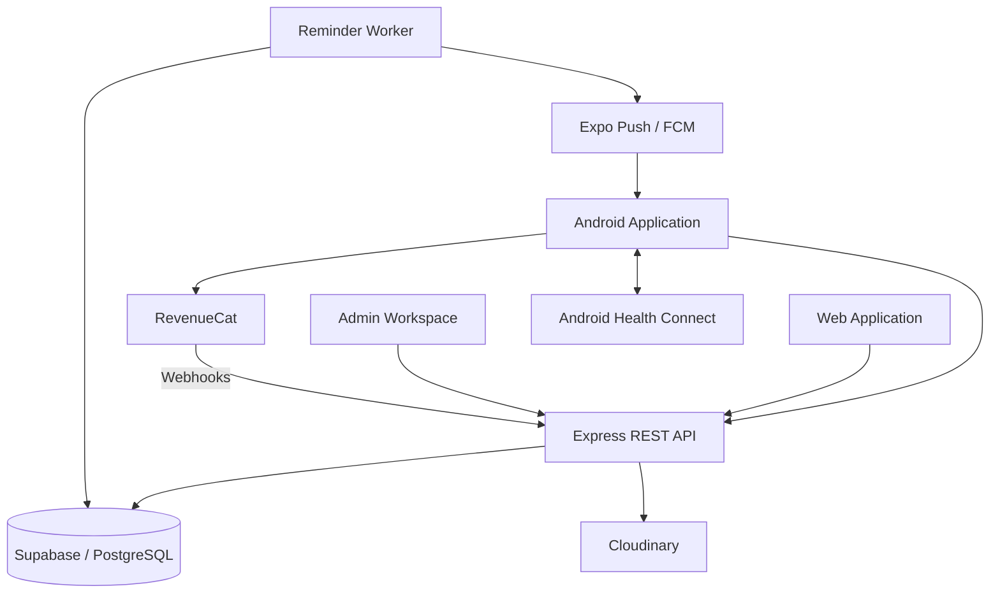

<div align="center">
  

  <h1>FitSync</h1>

  <p><strong>Train smarter. Track everything. Build consistency.</strong></p>

  <p>
    A fitness platform for structured training, workout tracking,
    personal coaching, and performance analytics.
  </p>

  <p>
    <a href="https://fitsync.top">Website</a>
    ·
    <a href="./docs/">Documentation</a>
    ·
    <a href="./docs/deployment.md">Deployment</a>
  </p>

  
  
  
  

</div>

---

## Overview

FitSync brings workout logging, structured training, personal
fitness plans, and meaningful progress tracking into one
connected experience.

The platform consists of an Android application, a web
application, a content management workspace, and a backend
API that manages training data, authentication, subscriptions,
and background operations.

## Features

### Workout & Training

- Real-time workout logging
- Custom workout routines
- Exercise library and instructions
- Structured training programs
- Rest timers and session recovery
- Set types, effort tracking, and workout notes
- Local workout journaling and synchronization

### Progress & Analytics

- Training volume and performance trends
- Personal records and exercise history
- Muscle group analysis
- Body measurements
- Weekly and long-term training statistics

### Personal Coaching

- Personalized four-week training plans
- Equipment and experience-based prescriptions
- Adaptive workout sessions
- Progression recommendations
- Weekly training reviews

### Health & Lifestyle

- Android Health Connect integration
- Mobility and recovery resources
- Nutrition and fitness tools
- Training calendar
- Scheduled workout reminders

### FitSync Pro

An optional membership providing advanced training analytics,
adaptive coaching, private custom exercises, and additional
training tools.

Subscriptions are managed through Google Play Billing and
RevenueCat, with premium access verified by the backend.

## Architecture



FitSync separates presentation, application logic, data
persistence, and external integrations into independently
maintained components.

## Technology Stack

| Layer | Technologies |
|---|---|
| Mobile | React Native, Expo, Expo Router |
| Web | Next.js, React, Tailwind CSS |
| Backend | Node.js, Express, TypeScript |
| Database | PostgreSQL, Supabase |
| Authentication | Google OAuth, JWT |
| Media | Cloudinary |
| Payments | RevenueCat, Google Play Billing |
| Notifications | Expo Notifications, Firebase Cloud Messaging |
| Health | Android Health Connect |
| Analytics | PostHog |
| Error Monitoring | Sentry |
| Infrastructure | Docker, Render, GitHub Actions |
| Mobile Distribution | Expo EAS, Google Play |

## Repository Structure

```text
fitsync/
├── mobile/       # Android application
├── web/          # Website and admin workspace
├── server/       # Backend API and background jobs
├── docs/         # Technical documentation
├── brand/        # Shared brand assets
├── .github/      # CI workflows
└── render.yaml   # Deployment configuration
```

Each application maintains its own dependencies,
environment configuration, and build process.

## Getting Started

### Prerequisites

- Node.js 22
- npm
- Git
- Supabase project
- Expo account
- Android device or emulator

### 1. Clone the repository

```bash
git clone https://github.com/SahilSahu731/fitsync.git
cd fitsync
```

### 2. Install dependencies

```bash
npm --prefix server ci
npm --prefix web ci
npm --prefix mobile ci
```

### 3. Configure environment variables

```bash
cp server/.env.example server/.env
cp web/.env.example web/.env.local
cp mobile/.env.example mobile/.env
```

Populate each environment file with the appropriate
development credentials.

Never commit private credentials, signing keys,
service account files, or production environment files.

### 4. Prepare the database

Apply the numbered SQL migrations according to the
[database migration guide](./server/sql/README.md).

Inspect existing databases before applying migrations.
Migrations are not executed automatically at application startup.

### 5. Start the backend

```bash
cd server
npm run dev
```

The API runs on port `4000` by default.

### 6. Start the website

In a separate terminal:

```bash
cd web
npm run dev
```

The website runs on `http://localhost:3000`.

### 7. Start the mobile application

Create and install an Android development build:

```bash
cd mobile
npm run build:android:dev
```

Start the development server:

```bash
EAS_BUILD_PROFILE=development npm run start:clean
```

Configure the mobile API URL using an address reachable
from your Android device.

> FitSync requires a native development or release build
> for integrations such as Google Sign-In, Health Connect,
> and subscription billing. Expo Go is not sufficient.

## Quality Assurance

### Backend

```bash
npm --prefix server run build
npm --prefix server test
npm --prefix server run test:sql
npm --prefix server run db:generate -- --check
```

### Web

```bash
npm --prefix web test
npm --prefix web run lint
npm --prefix web run build
```

### Mobile

```bash
npm --prefix mobile run typecheck
npm --prefix mobile run lint
npm --prefix mobile test
```

GitHub Actions runs automated verification on pushes
and pull requests, including Docker image builds.

SQL integration tests use isolated in-memory PostgreSQL
databases rather than production infrastructure.

## Documentation

| Document | Description |
|---|---|
| [Mobile](./mobile/README.md) | Android development and configuration |
| [Web](./web/README.md) | Website setup |
| [Database](./server/sql/README.md) | Schema and migrations |
| [Authentication](./docs/auth-design.md) | Authentication architecture |
| [Workout Tracking](./docs/workout-tracking.md) | Workout lifecycle |
| [Coaching](./docs/coaching.md) | Personal training engine |
| [Progress](./docs/progress-tracking.md) | Analytics and measurements |
| [Health Sync](./docs/health-sync.md) | Health Connect integration |
| [Billing](./docs/billing.md) | Subscription infrastructure |
| [Observability](./docs/observability-setup.md) | Monitoring and analytics |
| [Deployment](./docs/deployment.md) | Production infrastructure |
| [Play Store](./docs/play-store-release.md) | Android release process |

## Security & Privacy

FitSync uses authenticated API access, server-side
subscription verification, account-scoped data access,
secure token storage, and opt-in health permissions.

Sensitive service credentials are restricted to
server-side environments.

Production deployments must use HTTPS and complete
the documented security and release checks.

## Project Status

FitSync is under active development and production preparation.

Production deployment, provider configuration, and Google Play
distribution are tracked independently from feature implementation.

## Contact

- Website: [fitsync.top](https://fitsync.top)
- Support: [sahillsahudev@gmail.com](mailto:sahillsahudev@gmail.com)

---

<div align="center">
  <strong>FitSync</strong>
  <br />
  Built for the process, not just the results.
</div>
